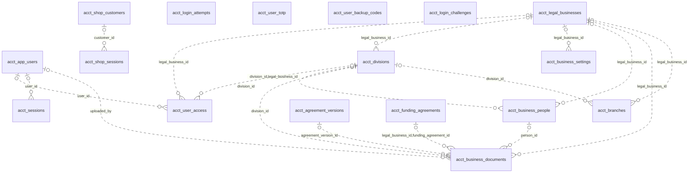

# Entity relationships

These diagrams show explicit foreign-key declarations in the checked-in SQL. Each child is assigned to one domain diagram; external parents can appear in several diagrams. The line is intentionally non-identifying and permits zero or one parent: column nullability and uniqueness are authoritative in the [dictionary](DATABASE_DICTIONARY.md). No one-to-one or mandatory relationship is inferred from a name. Logical links without SQL foreign keys are documented separately below.

## Organisation and access

## Funding and agreements

```mermaid
erDiagram
  acct_agreement_amendments
  acct_agreement_funding_policies
  acct_agreement_versions
  acct_amendment_evidence_reviews
  acct_funding_agreements
  acct_funding_parties
  acct_funding_transactions
  acct_historical_funding_batches
  acct_historical_funding_items
  acct_investor_bank_scopes
  acct_opening_funding_details
  acct_opening_investor_bank_balances
  acct_funding_agreements |o..o{ acct_agreement_amendments : "legal_business_id,agreement_id"
  acct_agreement_versions |o..o{ acct_agreement_amendments : "from_version_id"
  acct_app_users |o..o{ acct_agreement_amendments : "requested_by"
  acct_app_users |o..o{ acct_agreement_amendments : "reviewed_by"
  acct_agreement_versions |o..o{ acct_agreement_amendments : "to_version_id"
  acct_funding_agreements |o..o{ acct_agreement_funding_policies : "legal_business_id,agreement_id"
  acct_app_users |o..o{ acct_agreement_funding_policies : "created_by"
  acct_agreement_versions |o..o{ acct_agreement_funding_policies : "agreement_version_id"
  acct_funding_agreements |o..o{ acct_agreement_versions : "legal_business_id,agreement_id"
  acct_app_users |o..o{ acct_agreement_versions : "approved_by"
  acct_app_users |o..o{ acct_agreement_versions : "created_by"
  acct_legal_businesses |o..o{ acct_funding_agreements : "legal_business_id"
  acct_divisions |o..o{ acct_funding_agreements : "division_id"
  acct_funding_parties |o..o{ acct_funding_agreements : "legal_business_id,party_id"
  acct_app_users |o..o{ acct_funding_agreements : "created_by"
  acct_branches |o..o{ acct_funding_agreements : "branch_id"
  acct_legal_businesses |o..o{ acct_funding_parties : "legal_business_id"
  acct_funding_agreements |o..o{ acct_funding_transactions : "legal_business_id,agreement_id"
  acct_legal_businesses |o..o{ acct_funding_transactions : "legal_business_id"
  acct_journal_entries |o..o{ acct_funding_transactions : "journal_entry_id"
  acct_app_users |o..o{ acct_funding_transactions : "created_by"
  acct_agreement_versions |o..o{ acct_funding_transactions : "agreement_version_id"
  acct_app_users |o..o{ acct_historical_funding_batches : "approved_by"
  acct_legal_businesses |o..o{ acct_historical_funding_batches : "legal_business_id"
  acct_app_users |o..o{ acct_historical_funding_batches : "created_by"
  acct_funding_agreements |o..o{ acct_historical_funding_items : "legal_business_id,agreement_id"
  acct_historical_funding_batches |o..o{ acct_historical_funding_items : "legal_business_id,batch_id"
  acct_funding_transactions |o..o{ acct_historical_funding_items : "imported_transaction_id"
  acct_agreement_versions |o..o{ acct_historical_funding_items : "agreement_version_id"
  acct_bank_accounts |o..o{ acct_investor_bank_scopes : "bank_account_id"
  acct_branches |o..o{ acct_investor_bank_scopes : "legal_business_id,division_id,branch_id"
  acct_legal_businesses |o..o{ acct_investor_bank_scopes : "legal_business_id"
  acct_divisions |o..o{ acct_investor_bank_scopes : "division_id,legal_business_id"
  acct_funding_parties |o..o{ acct_investor_bank_scopes : "funding_party_id"
  acct_opening_balance_lines |o..o{ acct_opening_funding_details : "legal_business_id,opening_line_id"
  acct_funding_parties |o..o{ acct_opening_funding_details : "funding_party_id"
  acct_funding_agreements |o..o{ acct_opening_funding_details : "agreement_id"
```

## Ledger and opening balances

```mermaid
erDiagram
  acct_accounting_periods
  acct_auditor_adjustments
  acct_audit_events
  acct_chart_of_accounts
  acct_journal_entries
  acct_journal_lines
  acct_journal_post_sequences
  acct_journal_reversals
  acct_journal_sequences
  acct_opening_balance_authorizations
  acct_opening_balance_batches
  acct_opening_balance_lines
  acct_posting_failures
  acct_legal_businesses |o..o{ acct_audit_events : "legal_business_id"
  acct_app_users |o..o{ acct_audit_events : "actor_user_id"
  acct_chart_of_accounts |o..o{ acct_chart_of_accounts : "legal_business_id,parent_account_id"
  acct_legal_businesses |o..o{ acct_journal_entries : "legal_business_id"
  acct_financial_years |o..o{ acct_journal_entries : "financial_year_id,legal_business_id"
  acct_app_users |o..o{ acct_journal_entries : "created_by"
  acct_accounting_periods |o..o{ acct_journal_entries : "legal_business_id,accounting_period_id"
  acct_journal_entries |o..o{ acct_journal_lines : "journal_entry_id,legal_business_id"
  acct_chart_of_accounts |o..o{ acct_journal_lines : "account_id,legal_business_id"
  acct_divisions |o..o{ acct_journal_lines : "division_id,legal_business_id"
  acct_branches |o..o{ acct_journal_lines : "legal_business_id,division_id,branch_id"
  acct_financial_years |o..o{ acct_journal_post_sequences : "financial_year_id,legal_business_id"
  acct_app_users |o..o{ acct_journal_reversals : "reversed_by"
  acct_journal_entries |o..o{ acct_journal_reversals : "reversal_journal_id,legal_business_id"
  acct_journal_entries |o..o{ acct_journal_reversals : "original_journal_id,legal_business_id"
  acct_app_users |o..o{ acct_opening_balance_authorizations : "approved_by"
  acct_opening_balance_batches |o..o{ acct_opening_balance_authorizations : "legal_business_id,batch_id"
  acct_app_users |o..o{ acct_opening_balance_authorizations : "revoked_by"
  acct_legal_businesses |o..o{ acct_opening_balance_batches : "legal_business_id"
  acct_financial_years |o..o{ acct_opening_balance_batches : "financial_year_id,legal_business_id"
  acct_journal_entries |o..o{ acct_opening_balance_batches : "posted_journal_id,legal_business_id"
  acct_accounting_periods |o..o{ acct_opening_balance_batches : "legal_business_id,accounting_period_id"
  acct_chart_of_accounts |o..o{ acct_opening_balance_lines : "account_id,legal_business_id"
  acct_opening_balance_batches |o..o{ acct_opening_balance_lines : "legal_business_id,batch_id"
  acct_branches |o..o{ acct_opening_balance_lines : "legal_business_id,division_id,branch_id"
  acct_divisions |o..o{ acct_opening_balance_lines : "division_id,legal_business_id"
```

## Sales and customers

```mermaid
erDiagram
  acct_customers
  acct_customer_messages
  acct_offers
  acct_offer_products
  acct_online_orders
  acct_online_order_lines
  acct_sales_headers
  acct_sales_lines
  acct_sales_payments
  acct_sales_refunds
  acct_sales_returns
  acct_sales_return_lines
  acct_shop_customers
  acct_shop_password_resets
  acct_shop_email_verifications
  acct_sale_rewards
  acct_customer_notes
  acct_leads
  acct_deals
  acct_legal_businesses |o..o{ acct_customers : "legal_business_id"
  acct_offers |o..o{ acct_offer_products : "offer_id"
  acct_online_orders |o..o{ acct_online_order_lines : "order_id"
  acct_branches |o..o{ acct_sales_headers : "legal_business_id,division_id,branch_id"
  acct_legal_businesses |o..o{ acct_sales_headers : "legal_business_id"
  acct_app_users |o..o{ acct_sales_headers : "created_by"
  acct_inventory_locations |o..o{ acct_sales_headers : "legal_business_id,location_id"
  acct_app_users |o..o{ acct_sales_headers : "posted_by"
  acct_sales_headers |o..o{ acct_sales_lines : "legal_business_id,division_id,sale_id"
  acct_product_variants |o..o{ acct_sales_lines : "legal_business_id,division_id,variant_id"
  acct_app_users |o..o{ acct_sales_payments : "created_by"
  acct_sales_headers |o..o{ acct_sales_payments : "legal_business_id,division_id,sale_id"
  acct_shop_customers |o..o{ acct_shop_password_resets : "customer_id"
  acct_shop_customers |o..o{ acct_shop_email_verifications : "customer_id"
```

## Purchases and stock

```mermaid
erDiagram
  acct_approval_handouts
  acct_approval_items
  acct_free_stock
  acct_free_stock_lines
  acct_inventory_locations
  acct_products
  acct_product_categories
  acct_product_media
  acct_product_variants
  acct_purchase_headers
  acct_purchase_lines
  acct_purchase_orders
  acct_purchase_order_lines
  acct_purchase_payments
  acct_stock_counts
  acct_stock_count_lines
  acct_stock_damages
  acct_stock_drafts
  acct_stock_events
  acct_stock_movements
  acct_stock_reporters
  acct_stock_transfers
  acct_stock_transfer_lines
  acct_suppliers
  acct_supplier_refunds
  acct_supplier_returns
  acct_supplier_return_lines
  acct_supplier_return_replacements
  acct_stock_finds
  acct_serials
  acct_branches |o..o{ acct_inventory_locations : "legal_business_id,division_id,branch_id"
  acct_legal_businesses |o..o{ acct_inventory_locations : "legal_business_id"
  acct_app_users |o..o{ acct_inventory_locations : "created_by"
  acct_divisions |o..o{ acct_inventory_locations : "division_id,legal_business_id"
  acct_product_categories |o..o{ acct_products : "legal_business_id,division_id,category_id"
  acct_app_users |o..o{ acct_products : "created_by"
  acct_divisions |o..o{ acct_products : "division_id,legal_business_id"
  acct_app_users |o..o{ acct_product_categories : "created_by"
  acct_divisions |o..o{ acct_product_categories : "division_id,legal_business_id"
  acct_product_categories |o..o{ acct_product_categories : "legal_business_id,division_id,parent_category_id"
  acct_app_users |o..o{ acct_product_variants : "created_by"
  acct_products |o..o{ acct_product_variants : "legal_business_id,division_id,product_id"
  acct_app_users |o..o{ acct_purchase_headers : "created_by"
  acct_divisions |o..o{ acct_purchase_headers : "division_id,legal_business_id"
  acct_inventory_locations |o..o{ acct_purchase_headers : "legal_business_id,receiving_location_id"
  acct_app_users |o..o{ acct_purchase_headers : "posted_by"
  acct_suppliers |o..o{ acct_purchase_headers : "legal_business_id,supplier_id"
  acct_purchase_headers |o..o{ acct_purchase_lines : "legal_business_id,division_id,purchase_id"
  acct_product_variants |o..o{ acct_purchase_lines : "legal_business_id,division_id,variant_id"
  acct_app_users |o..o{ acct_purchase_payments : "created_by"
  acct_funding_agreements |o..o{ acct_purchase_payments : "legal_business_id,funding_agreement_id"
  acct_funding_parties |o..o{ acct_purchase_payments : "funding_party_id"
  acct_journal_entries |o..o{ acct_purchase_payments : "journal_entry_id"
  acct_purchase_headers |o..o{ acct_purchase_payments : "legal_business_id,division_id,purchase_id"
  acct_bank_accounts |o..o{ acct_purchase_payments : "source_bank_account_id"
  acct_cash_accounts |o..o{ acct_purchase_payments : "source_cash_account_id"
  acct_app_users |o..o{ acct_purchase_payments : "verified_by"
  acct_app_users |o..o{ acct_stock_movements : "created_by"
  acct_inventory_locations |o..o{ acct_stock_movements : "legal_business_id,location_id"
  acct_product_variants |o..o{ acct_stock_movements : "legal_business_id,division_id,variant_id"
  acct_app_users |o..o{ acct_stock_transfers : "created_by"
  acct_app_users |o..o{ acct_stock_transfers : "dispatched_by"
  acct_inventory_locations |o..o{ acct_stock_transfers : "legal_business_id,from_location_id"
  acct_app_users |o..o{ acct_stock_transfers : "received_by"
  acct_inventory_locations |o..o{ acct_stock_transfers : "legal_business_id,to_location_id"
  acct_stock_transfers |o..o{ acct_stock_transfer_lines : "legal_business_id,division_id,transfer_id"
  acct_product_variants |o..o{ acct_stock_transfer_lines : "legal_business_id,division_id,variant_id"
  acct_legal_businesses |o..o{ acct_suppliers : "legal_business_id"
  acct_app_users |o..o{ acct_suppliers : "created_by"
```

## Cash, expenses and administration

```mermaid
erDiagram
  acct_advances
  acct_advance_transactions
  acct_asset_depreciation
  acct_asset_dep_runs
  acct_bank_accounts
  acct_bank_evidence
  acct_bank_verifications
  acct_cash_accounts
  acct_cash_closings
  acct_document_sequences
  acct_employees
  acct_expenses
  acct_expense_payments
  acct_financial_scenarios
  acct_financial_years
  acct_fixed_assets
  acct_instagram_posts
  acct_invoice_shares
  acct_owner_money
  acct_party_setoffs
  acct_party_setoff_lines
  acct_profit_allocations
  acct_profit_waterfall_policies
  acct_salary_payments
  acct_scenario_assumptions
  acct_staff_advances
  acct_staff_advance_recoveries
  acct_whatsapp_outbox
  acct_whatsapp_recipients
  acct_whatsapp_subscriptions
  acct_bot_answers
  acct_bot_conversations
  acct_bot_messages
  acct_vouchers
  acct_document_copies
  acct_document_log
  acct_selling_prices
  acct_bank_statement_lines
  acct_employee_pay_history
  acct_coupons
  acct_bill_terms
  acct_cash_note_log
  acct_reel_tracks
  acct_wa_broadcasts
  acct_wa_broadcast_recipients
  acct_wa_delivery
  acct_owner_accounts
  acct_wa_status_log
  acct_branches |o..o{ acct_advances : "legal_business_id,division_id,branch_id"
  acct_legal_businesses |o..o{ acct_advances : "legal_business_id"
  acct_app_users |o..o{ acct_advances : "created_by"
  acct_advances |o..o{ acct_advance_transactions : "legal_business_id,advance_id"
  acct_bank_accounts |o..o{ acct_advance_transactions : "bank_account_id"
  acct_cash_accounts |o..o{ acct_advance_transactions : "cash_account_id"
  acct_app_users |o..o{ acct_advance_transactions : "created_by"
  acct_funding_parties |o..o{ acct_advance_transactions : "legal_business_id,funding_party_id"
  acct_chart_of_accounts |o..o{ acct_bank_accounts : "legal_business_id,gl_account_id"
  acct_bank_accounts |o..o{ acct_bank_evidence : "bank_account_id"
  acct_bank_evidence |o..o{ acct_bank_verifications : "evidence_document_id"
  acct_bank_accounts |o..o{ acct_bank_verifications : "bank_account_id"
  acct_branches |o..o{ acct_cash_accounts : "legal_business_id,division_id,branch_id"
  acct_legal_businesses |o..o{ acct_cash_accounts : "legal_business_id"
  acct_divisions |o..o{ acct_cash_accounts : "division_id,legal_business_id"
  acct_chart_of_accounts |o..o{ acct_cash_accounts : "legal_business_id,gl_account_id"
  acct_legal_businesses |o..o{ acct_document_sequences : "legal_business_id"
  acct_branches |o..o{ acct_expenses : "legal_business_id,division_id,branch_id"
  acct_legal_businesses |o..o{ acct_expenses : "legal_business_id"
  acct_app_users |o..o{ acct_expenses : "confirmed_by"
  acct_app_users |o..o{ acct_expenses : "created_by"
  acct_bank_accounts |o..o{ acct_expense_payments : "bank_account_id"
  acct_cash_accounts |o..o{ acct_expense_payments : "cash_account_id"
  acct_app_users |o..o{ acct_expense_payments : "created_by"
  acct_expenses |o..o{ acct_expense_payments : "legal_business_id,expense_id"
  acct_funding_parties |o..o{ acct_expense_payments : "legal_business_id,funding_party_id"
  acct_legal_businesses |o..o{ acct_financial_scenarios : "legal_business_id"
  acct_divisions |o..o{ acct_financial_scenarios : "division_id,legal_business_id"
  acct_app_users |o..o{ acct_financial_scenarios : "created_by"
  acct_legal_businesses |o..o{ acct_financial_years : "legal_business_id"
  acct_funding_agreements |o..o{ acct_profit_allocations : "legal_business_id,agreement_id"
  acct_app_users |o..o{ acct_profit_allocations : "approved_by"
  acct_legal_businesses |o..o{ acct_profit_allocations : "legal_business_id"
  acct_legal_businesses |o..o{ acct_profit_waterfall_policies : "legal_business_id"
  acct_app_users |o..o{ acct_profit_waterfall_policies : "created_by"
  acct_divisions |o..o{ acct_profit_waterfall_policies : "division_id"
  acct_financial_scenarios |o..o{ acct_scenario_assumptions : "scenario_id"
  acct_whatsapp_subscriptions |o..o{ acct_whatsapp_outbox : "subscription_id"
  acct_legal_businesses |o..o{ acct_whatsapp_recipients : "legal_business_id"
  acct_app_users |o..o{ acct_whatsapp_recipients : "created_by"
  acct_whatsapp_recipients |o..o{ acct_whatsapp_subscriptions : "recipient_id"
```

## Foreign-key evidence

| Child | Child columns | Parent | Parent columns | Source |
| --- | --- | --- | --- | --- |
| acct_advances | legal_business_id,division_id,branch_id | acct_branches | legal_business_id, division_id, id | [db/base_schema_2026-10-28.sql](../../db/base_schema_2026-10-28.sql) |
| acct_advances | legal_business_id | acct_legal_businesses | id | [db/base_schema_2026-10-28.sql](../../db/base_schema_2026-10-28.sql) |
| acct_advances | created_by | acct_app_users | id | [db/base_schema_2026-10-28.sql](../../db/base_schema_2026-10-28.sql) |
| acct_advance_transactions | legal_business_id,advance_id | acct_advances | legal_business_id, id | [db/base_schema_2026-10-28.sql](../../db/base_schema_2026-10-28.sql) |
| acct_advance_transactions | bank_account_id | acct_bank_accounts | id | [db/base_schema_2026-10-28.sql](../../db/base_schema_2026-10-28.sql) |
| acct_advance_transactions | cash_account_id | acct_cash_accounts | id | [db/base_schema_2026-10-28.sql](../../db/base_schema_2026-10-28.sql) |
| acct_advance_transactions | created_by | acct_app_users | id | [db/base_schema_2026-10-28.sql](../../db/base_schema_2026-10-28.sql) |
| acct_advance_transactions | legal_business_id,funding_party_id | acct_funding_parties | legal_business_id, id | [db/base_schema_2026-10-28.sql](../../db/base_schema_2026-10-28.sql) |
| acct_agreement_amendments | legal_business_id,agreement_id | acct_funding_agreements | legal_business_id, id | [db/base_schema_2026-10-28.sql](../../db/base_schema_2026-10-28.sql) |
| acct_agreement_amendments | from_version_id | acct_agreement_versions | id | [db/base_schema_2026-10-28.sql](../../db/base_schema_2026-10-28.sql) |
| acct_agreement_amendments | requested_by | acct_app_users | id | [db/base_schema_2026-10-28.sql](../../db/base_schema_2026-10-28.sql) |
| acct_agreement_amendments | reviewed_by | acct_app_users | id | [db/base_schema_2026-10-28.sql](../../db/base_schema_2026-10-28.sql) |
| acct_agreement_amendments | to_version_id | acct_agreement_versions | id | [db/base_schema_2026-10-28.sql](../../db/base_schema_2026-10-28.sql) |
| acct_agreement_funding_policies | legal_business_id,agreement_id | acct_funding_agreements | legal_business_id, id | [db/base_schema_2026-10-28.sql](../../db/base_schema_2026-10-28.sql) |
| acct_agreement_funding_policies | created_by | acct_app_users | id | [db/base_schema_2026-10-28.sql](../../db/base_schema_2026-10-28.sql) |
| acct_agreement_funding_policies | agreement_version_id | acct_agreement_versions | id | [db/base_schema_2026-10-28.sql](../../db/base_schema_2026-10-28.sql) |
| acct_agreement_versions | legal_business_id,agreement_id | acct_funding_agreements | legal_business_id, id | [db/base_schema_2026-10-28.sql](../../db/base_schema_2026-10-28.sql) |
| acct_agreement_versions | approved_by | acct_app_users | id | [db/base_schema_2026-10-28.sql](../../db/base_schema_2026-10-28.sql) |
| acct_agreement_versions | created_by | acct_app_users | id | [db/base_schema_2026-10-28.sql](../../db/base_schema_2026-10-28.sql) |
| acct_audit_events | legal_business_id | acct_legal_businesses | id | [db/base_schema_2026-10-28.sql](../../db/base_schema_2026-10-28.sql) |
| acct_audit_events | actor_user_id | acct_app_users | id | [db/base_schema_2026-10-28.sql](../../db/base_schema_2026-10-28.sql) |
| acct_bank_accounts | legal_business_id,gl_account_id | acct_chart_of_accounts | legal_business_id, id | [db/base_schema_2026-10-28.sql](../../db/base_schema_2026-10-28.sql) |
| acct_bank_evidence | bank_account_id | acct_bank_accounts | id | [db/base_schema_2026-10-28.sql](../../db/base_schema_2026-10-28.sql) |
| acct_bank_verifications | evidence_document_id | acct_bank_evidence | id | [db/base_schema_2026-10-28.sql](../../db/base_schema_2026-10-28.sql) |
| acct_bank_verifications | bank_account_id | acct_bank_accounts | id | [db/base_schema_2026-10-28.sql](../../db/base_schema_2026-10-28.sql) |
| acct_branches | legal_business_id | acct_legal_businesses | id | [db/base_schema_2026-10-28.sql](../../db/base_schema_2026-10-28.sql) |
| acct_branches | division_id | acct_divisions | id | [db/base_schema_2026-10-28.sql](../../db/base_schema_2026-10-28.sql) |
| acct_business_documents | agreement_version_id | acct_agreement_versions | id | [db/base_schema_2026-10-28.sql](../../db/base_schema_2026-10-28.sql) |
| acct_business_documents | legal_business_id,funding_agreement_id | acct_funding_agreements | legal_business_id, id | [db/base_schema_2026-10-28.sql](../../db/base_schema_2026-10-28.sql) |
| acct_business_documents | legal_business_id | acct_legal_businesses | id | [db/base_schema_2026-10-28.sql](../../db/base_schema_2026-10-28.sql) |
| acct_business_documents | division_id | acct_divisions | id | [db/base_schema_2026-10-28.sql](../../db/base_schema_2026-10-28.sql) |
| acct_business_documents | person_id | acct_business_people | id | [db/base_schema_2026-10-28.sql](../../db/base_schema_2026-10-28.sql) |
| acct_business_documents | uploaded_by | acct_app_users | id | [db/base_schema_2026-10-28.sql](../../db/base_schema_2026-10-28.sql) |
| acct_business_people | legal_business_id | acct_legal_businesses | id | [db/base_schema_2026-10-28.sql](../../db/base_schema_2026-10-28.sql) |
| acct_business_people | division_id | acct_divisions | id | [db/base_schema_2026-10-28.sql](../../db/base_schema_2026-10-28.sql) |
| acct_business_settings | legal_business_id | acct_legal_businesses | id | [db/base_schema_2026-10-28.sql](../../db/base_schema_2026-10-28.sql) |
| acct_cash_accounts | legal_business_id,division_id,branch_id | acct_branches | legal_business_id, division_id, id | [db/base_schema_2026-10-28.sql](../../db/base_schema_2026-10-28.sql) |
| acct_cash_accounts | legal_business_id | acct_legal_businesses | id | [db/base_schema_2026-10-28.sql](../../db/base_schema_2026-10-28.sql) |
| acct_cash_accounts | division_id,legal_business_id | acct_divisions | id, legal_business_id | [db/base_schema_2026-10-28.sql](../../db/base_schema_2026-10-28.sql) |
| acct_cash_accounts | legal_business_id,gl_account_id | acct_chart_of_accounts | legal_business_id, id | [db/base_schema_2026-10-28.sql](../../db/base_schema_2026-10-28.sql) |
| acct_chart_of_accounts | legal_business_id,parent_account_id | acct_chart_of_accounts | legal_business_id, id | [db/base_schema_2026-10-28.sql](../../db/base_schema_2026-10-28.sql) |
| acct_customers | legal_business_id | acct_legal_businesses | id | [db/base_schema_2026-10-28.sql](../../db/base_schema_2026-10-28.sql) |
| acct_divisions | legal_business_id | acct_legal_businesses | id | [db/base_schema_2026-10-28.sql](../../db/base_schema_2026-10-28.sql) |
| acct_document_sequences | legal_business_id | acct_legal_businesses | id | [db/base_schema_2026-10-28.sql](../../db/base_schema_2026-10-28.sql) |
| acct_expenses | legal_business_id,division_id,branch_id | acct_branches | legal_business_id, division_id, id | [db/base_schema_2026-10-28.sql](../../db/base_schema_2026-10-28.sql) |
| acct_expenses | legal_business_id | acct_legal_businesses | id | [db/base_schema_2026-10-28.sql](../../db/base_schema_2026-10-28.sql) |
| acct_expenses | confirmed_by | acct_app_users | id | [db/base_schema_2026-10-28.sql](../../db/base_schema_2026-10-28.sql) |
| acct_expenses | created_by | acct_app_users | id | [db/base_schema_2026-10-28.sql](../../db/base_schema_2026-10-28.sql) |
| acct_expense_payments | bank_account_id | acct_bank_accounts | id | [db/base_schema_2026-10-28.sql](../../db/base_schema_2026-10-28.sql) |
| acct_expense_payments | cash_account_id | acct_cash_accounts | id | [db/base_schema_2026-10-28.sql](../../db/base_schema_2026-10-28.sql) |
| acct_expense_payments | created_by | acct_app_users | id | [db/base_schema_2026-10-28.sql](../../db/base_schema_2026-10-28.sql) |
| acct_expense_payments | legal_business_id,expense_id | acct_expenses | legal_business_id, id | [db/base_schema_2026-10-28.sql](../../db/base_schema_2026-10-28.sql) |
| acct_expense_payments | legal_business_id,funding_party_id | acct_funding_parties | legal_business_id, id | [db/base_schema_2026-10-28.sql](../../db/base_schema_2026-10-28.sql) |
| acct_financial_scenarios | legal_business_id | acct_legal_businesses | id | [db/base_schema_2026-10-28.sql](../../db/base_schema_2026-10-28.sql) |
| acct_financial_scenarios | division_id,legal_business_id | acct_divisions | id, legal_business_id | [db/base_schema_2026-10-28.sql](../../db/base_schema_2026-10-28.sql) |
| acct_financial_scenarios | created_by | acct_app_users | id | [db/base_schema_2026-10-28.sql](../../db/base_schema_2026-10-28.sql) |
| acct_financial_years | legal_business_id | acct_legal_businesses | id | [db/base_schema_2026-10-28.sql](../../db/base_schema_2026-10-28.sql) |
| acct_funding_agreements | legal_business_id | acct_legal_businesses | id | [db/base_schema_2026-10-28.sql](../../db/base_schema_2026-10-28.sql) |
| acct_funding_agreements | division_id | acct_divisions | id | [db/base_schema_2026-10-28.sql](../../db/base_schema_2026-10-28.sql) |
| acct_funding_agreements | legal_business_id,party_id | acct_funding_parties | legal_business_id, id | [db/base_schema_2026-10-28.sql](../../db/base_schema_2026-10-28.sql) |
| acct_funding_agreements | created_by | acct_app_users | id | [db/base_schema_2026-10-28.sql](../../db/base_schema_2026-10-28.sql) |
| acct_funding_agreements | branch_id | acct_branches | id | [db/base_schema_2026-10-28.sql](../../db/base_schema_2026-10-28.sql) |
| acct_funding_parties | legal_business_id | acct_legal_businesses | id | [db/base_schema_2026-10-28.sql](../../db/base_schema_2026-10-28.sql) |
| acct_funding_transactions | legal_business_id,agreement_id | acct_funding_agreements | legal_business_id, id | [db/base_schema_2026-10-28.sql](../../db/base_schema_2026-10-28.sql) |
| acct_funding_transactions | legal_business_id | acct_legal_businesses | id | [db/base_schema_2026-10-28.sql](../../db/base_schema_2026-10-28.sql) |
| acct_funding_transactions | journal_entry_id | acct_journal_entries | id | [db/base_schema_2026-10-28.sql](../../db/base_schema_2026-10-28.sql) |
| acct_funding_transactions | created_by | acct_app_users | id | [db/base_schema_2026-10-28.sql](../../db/base_schema_2026-10-28.sql) |
| acct_funding_transactions | agreement_version_id | acct_agreement_versions | id | [db/base_schema_2026-10-28.sql](../../db/base_schema_2026-10-28.sql) |
| acct_historical_funding_batches | approved_by | acct_app_users | id | [db/base_schema_2026-10-28.sql](../../db/base_schema_2026-10-28.sql) |
| acct_historical_funding_batches | legal_business_id | acct_legal_businesses | id | [db/base_schema_2026-10-28.sql](../../db/base_schema_2026-10-28.sql) |
| acct_historical_funding_batches | created_by | acct_app_users | id | [db/base_schema_2026-10-28.sql](../../db/base_schema_2026-10-28.sql) |
| acct_historical_funding_items | legal_business_id,agreement_id | acct_funding_agreements | legal_business_id, id | [db/base_schema_2026-10-28.sql](../../db/base_schema_2026-10-28.sql) |
| acct_historical_funding_items | legal_business_id,batch_id | acct_historical_funding_batches | legal_business_id, id | [db/base_schema_2026-10-28.sql](../../db/base_schema_2026-10-28.sql) |
| acct_historical_funding_items | imported_transaction_id | acct_funding_transactions | id | [db/base_schema_2026-10-28.sql](../../db/base_schema_2026-10-28.sql) |
| acct_historical_funding_items | agreement_version_id | acct_agreement_versions | id | [db/base_schema_2026-10-28.sql](../../db/base_schema_2026-10-28.sql) |
| acct_inventory_locations | legal_business_id,division_id,branch_id | acct_branches | legal_business_id, division_id, id | [db/base_schema_2026-10-28.sql](../../db/base_schema_2026-10-28.sql) |
| acct_inventory_locations | legal_business_id | acct_legal_businesses | id | [db/base_schema_2026-10-28.sql](../../db/base_schema_2026-10-28.sql) |
| acct_inventory_locations | created_by | acct_app_users | id | [db/base_schema_2026-10-28.sql](../../db/base_schema_2026-10-28.sql) |
| acct_inventory_locations | division_id,legal_business_id | acct_divisions | id, legal_business_id | [db/base_schema_2026-10-28.sql](../../db/base_schema_2026-10-28.sql) |
| acct_investor_bank_scopes | bank_account_id | acct_bank_accounts | id | [db/base_schema_2026-10-28.sql](../../db/base_schema_2026-10-28.sql) |
| acct_investor_bank_scopes | legal_business_id,division_id,branch_id | acct_branches | legal_business_id, division_id, id | [db/base_schema_2026-10-28.sql](../../db/base_schema_2026-10-28.sql) |
| acct_investor_bank_scopes | legal_business_id | acct_legal_businesses | id | [db/base_schema_2026-10-28.sql](../../db/base_schema_2026-10-28.sql) |
| acct_investor_bank_scopes | division_id,legal_business_id | acct_divisions | id, legal_business_id | [db/base_schema_2026-10-28.sql](../../db/base_schema_2026-10-28.sql) |
| acct_investor_bank_scopes | funding_party_id | acct_funding_parties | id | [db/base_schema_2026-10-28.sql](../../db/base_schema_2026-10-28.sql) |
| acct_journal_entries | legal_business_id | acct_legal_businesses | id | [db/base_schema_2026-10-28.sql](../../db/base_schema_2026-10-28.sql) |
| acct_journal_entries | financial_year_id,legal_business_id | acct_financial_years | id, legal_business_id | [db/base_schema_2026-10-28.sql](../../db/base_schema_2026-10-28.sql) |
| acct_journal_entries | created_by | acct_app_users | id | [db/base_schema_2026-10-28.sql](../../db/base_schema_2026-10-28.sql) |
| acct_journal_entries | legal_business_id,accounting_period_id | acct_accounting_periods | legal_business_id, id | [db/base_schema_2026-10-28.sql](../../db/base_schema_2026-10-28.sql) |
| acct_journal_lines | journal_entry_id,legal_business_id | acct_journal_entries | id, legal_business_id | [db/base_schema_2026-10-28.sql](../../db/base_schema_2026-10-28.sql) |
| acct_journal_lines | account_id,legal_business_id | acct_chart_of_accounts | id, legal_business_id | [db/base_schema_2026-10-28.sql](../../db/base_schema_2026-10-28.sql) |
| acct_journal_lines | division_id,legal_business_id | acct_divisions | id, legal_business_id | [db/base_schema_2026-10-28.sql](../../db/base_schema_2026-10-28.sql) |
| acct_journal_lines | legal_business_id,division_id,branch_id | acct_branches | legal_business_id, division_id, id | [db/base_schema_2026-10-28.sql](../../db/base_schema_2026-10-28.sql) |
| acct_journal_post_sequences | financial_year_id,legal_business_id | acct_financial_years | id, legal_business_id | [db/base_schema_2026-10-28.sql](../../db/base_schema_2026-10-28.sql) |
| acct_journal_reversals | reversed_by | acct_app_users | id | [db/base_schema_2026-10-28.sql](../../db/base_schema_2026-10-28.sql) |
| acct_journal_reversals | reversal_journal_id,legal_business_id | acct_journal_entries | id, legal_business_id | [db/base_schema_2026-10-28.sql](../../db/base_schema_2026-10-28.sql) |
| acct_journal_reversals | original_journal_id,legal_business_id | acct_journal_entries | id, legal_business_id | [db/base_schema_2026-10-28.sql](../../db/base_schema_2026-10-28.sql) |
| acct_offer_products | offer_id | acct_offers | id | [db/base_schema_2026-10-28.sql](../../db/base_schema_2026-10-28.sql) |
| acct_online_order_lines | order_id | acct_online_orders | id | [db/base_schema_2026-10-28.sql](../../db/base_schema_2026-10-28.sql) |
| acct_opening_balance_authorizations | approved_by | acct_app_users | id | [db/base_schema_2026-10-28.sql](../../db/base_schema_2026-10-28.sql) |
| acct_opening_balance_authorizations | legal_business_id,batch_id | acct_opening_balance_batches | legal_business_id, id | [db/base_schema_2026-10-28.sql](../../db/base_schema_2026-10-28.sql) |
| acct_opening_balance_authorizations | revoked_by | acct_app_users | id | [db/base_schema_2026-10-28.sql](../../db/base_schema_2026-10-28.sql) |
| acct_opening_balance_batches | legal_business_id | acct_legal_businesses | id | [db/base_schema_2026-10-28.sql](../../db/base_schema_2026-10-28.sql) |
| acct_opening_balance_batches | financial_year_id,legal_business_id | acct_financial_years | id, legal_business_id | [db/base_schema_2026-10-28.sql](../../db/base_schema_2026-10-28.sql) |
| acct_opening_balance_batches | posted_journal_id,legal_business_id | acct_journal_entries | id, legal_business_id | [db/base_schema_2026-10-28.sql](../../db/base_schema_2026-10-28.sql) |
| acct_opening_balance_batches | legal_business_id,accounting_period_id | acct_accounting_periods | legal_business_id, id | [db/base_schema_2026-10-28.sql](../../db/base_schema_2026-10-28.sql) |
| acct_opening_balance_lines | account_id,legal_business_id | acct_chart_of_accounts | id, legal_business_id | [db/base_schema_2026-10-28.sql](../../db/base_schema_2026-10-28.sql) |
| acct_opening_balance_lines | legal_business_id,batch_id | acct_opening_balance_batches | legal_business_id, id | [db/base_schema_2026-10-28.sql](../../db/base_schema_2026-10-28.sql) |
| acct_opening_balance_lines | legal_business_id,division_id,branch_id | acct_branches | legal_business_id, division_id, id | [db/base_schema_2026-10-28.sql](../../db/base_schema_2026-10-28.sql) |
| acct_opening_balance_lines | division_id,legal_business_id | acct_divisions | id, legal_business_id | [db/base_schema_2026-10-28.sql](../../db/base_schema_2026-10-28.sql) |
| acct_opening_funding_details | legal_business_id,opening_line_id | acct_opening_balance_lines | legal_business_id, id | [db/base_schema_2026-10-28.sql](../../db/base_schema_2026-10-28.sql) |
| acct_opening_funding_details | funding_party_id | acct_funding_parties | id | [db/base_schema_2026-10-28.sql](../../db/base_schema_2026-10-28.sql) |
| acct_opening_funding_details | agreement_id | acct_funding_agreements | id | [db/base_schema_2026-10-28.sql](../../db/base_schema_2026-10-28.sql) |
| acct_products | legal_business_id,division_id,category_id | acct_product_categories | legal_business_id, division_id, id | [db/base_schema_2026-10-28.sql](../../db/base_schema_2026-10-28.sql) |
| acct_products | created_by | acct_app_users | id | [db/base_schema_2026-10-28.sql](../../db/base_schema_2026-10-28.sql) |
| acct_products | division_id,legal_business_id | acct_divisions | id, legal_business_id | [db/base_schema_2026-10-28.sql](../../db/base_schema_2026-10-28.sql) |
| acct_product_categories | created_by | acct_app_users | id | [db/base_schema_2026-10-28.sql](../../db/base_schema_2026-10-28.sql) |
| acct_product_categories | division_id,legal_business_id | acct_divisions | id, legal_business_id | [db/base_schema_2026-10-28.sql](../../db/base_schema_2026-10-28.sql) |
| acct_product_categories | legal_business_id,division_id,parent_category_id | acct_product_categories | legal_business_id, division_id, id | [db/base_schema_2026-10-28.sql](../../db/base_schema_2026-10-28.sql) |
| acct_product_variants | created_by | acct_app_users | id | [db/base_schema_2026-10-28.sql](../../db/base_schema_2026-10-28.sql) |
| acct_product_variants | legal_business_id,division_id,product_id | acct_products | legal_business_id, division_id, id | [db/base_schema_2026-10-28.sql](../../db/base_schema_2026-10-28.sql) |
| acct_profit_allocations | legal_business_id,agreement_id | acct_funding_agreements | legal_business_id, id | [db/base_schema_2026-10-28.sql](../../db/base_schema_2026-10-28.sql) |
| acct_profit_allocations | approved_by | acct_app_users | id | [db/base_schema_2026-10-28.sql](../../db/base_schema_2026-10-28.sql) |
| acct_profit_allocations | legal_business_id | acct_legal_businesses | id | [db/base_schema_2026-10-28.sql](../../db/base_schema_2026-10-28.sql) |
| acct_profit_waterfall_policies | legal_business_id | acct_legal_businesses | id | [db/base_schema_2026-10-28.sql](../../db/base_schema_2026-10-28.sql) |
| acct_profit_waterfall_policies | created_by | acct_app_users | id | [db/base_schema_2026-10-28.sql](../../db/base_schema_2026-10-28.sql) |
| acct_profit_waterfall_policies | division_id | acct_divisions | id | [db/base_schema_2026-10-28.sql](../../db/base_schema_2026-10-28.sql) |
| acct_purchase_headers | created_by | acct_app_users | id | [db/base_schema_2026-10-28.sql](../../db/base_schema_2026-10-28.sql) |
| acct_purchase_headers | division_id,legal_business_id | acct_divisions | id, legal_business_id | [db/base_schema_2026-10-28.sql](../../db/base_schema_2026-10-28.sql) |
| acct_purchase_headers | legal_business_id,receiving_location_id | acct_inventory_locations | legal_business_id, id | [db/base_schema_2026-10-28.sql](../../db/base_schema_2026-10-28.sql) |
| acct_purchase_headers | posted_by | acct_app_users | id | [db/base_schema_2026-10-28.sql](../../db/base_schema_2026-10-28.sql) |
| acct_purchase_headers | legal_business_id,supplier_id | acct_suppliers | legal_business_id, id | [db/base_schema_2026-10-28.sql](../../db/base_schema_2026-10-28.sql) |
| acct_purchase_lines | legal_business_id,division_id,purchase_id | acct_purchase_headers | legal_business_id, division_id, id | [db/base_schema_2026-10-28.sql](../../db/base_schema_2026-10-28.sql) |
| acct_purchase_lines | legal_business_id,division_id,variant_id | acct_product_variants | legal_business_id, division_id, id | [db/base_schema_2026-10-28.sql](../../db/base_schema_2026-10-28.sql) |
| acct_purchase_payments | created_by | acct_app_users | id | [db/base_schema_2026-10-28.sql](../../db/base_schema_2026-10-28.sql) |
| acct_purchase_payments | legal_business_id,funding_agreement_id | acct_funding_agreements | legal_business_id, id | [db/base_schema_2026-10-28.sql](../../db/base_schema_2026-10-28.sql) |
| acct_purchase_payments | funding_party_id | acct_funding_parties | id | [db/base_schema_2026-10-28.sql](../../db/base_schema_2026-10-28.sql) |
| acct_purchase_payments | journal_entry_id | acct_journal_entries | id | [db/base_schema_2026-10-28.sql](../../db/base_schema_2026-10-28.sql) |
| acct_purchase_payments | legal_business_id,division_id,purchase_id | acct_purchase_headers | legal_business_id, division_id, id | [db/base_schema_2026-10-28.sql](../../db/base_schema_2026-10-28.sql) |
| acct_purchase_payments | source_bank_account_id | acct_bank_accounts | id | [db/base_schema_2026-10-28.sql](../../db/base_schema_2026-10-28.sql) |
| acct_purchase_payments | source_cash_account_id | acct_cash_accounts | id | [db/base_schema_2026-10-28.sql](../../db/base_schema_2026-10-28.sql) |
| acct_purchase_payments | verified_by | acct_app_users | id | [db/base_schema_2026-10-28.sql](../../db/base_schema_2026-10-28.sql) |
| acct_sales_headers | legal_business_id,division_id,branch_id | acct_branches | legal_business_id, division_id, id | [db/base_schema_2026-10-28.sql](../../db/base_schema_2026-10-28.sql) |
| acct_sales_headers | legal_business_id | acct_legal_businesses | id | [db/base_schema_2026-10-28.sql](../../db/base_schema_2026-10-28.sql) |
| acct_sales_headers | created_by | acct_app_users | id | [db/base_schema_2026-10-28.sql](../../db/base_schema_2026-10-28.sql) |
| acct_sales_headers | legal_business_id,location_id | acct_inventory_locations | legal_business_id, id | [db/base_schema_2026-10-28.sql](../../db/base_schema_2026-10-28.sql) |
| acct_sales_headers | posted_by | acct_app_users | id | [db/base_schema_2026-10-28.sql](../../db/base_schema_2026-10-28.sql) |
| acct_sales_lines | legal_business_id,division_id,sale_id | acct_sales_headers | legal_business_id, division_id, id | [db/base_schema_2026-10-28.sql](../../db/base_schema_2026-10-28.sql) |
| acct_sales_lines | legal_business_id,division_id,variant_id | acct_product_variants | legal_business_id, division_id, id | [db/base_schema_2026-10-28.sql](../../db/base_schema_2026-10-28.sql) |
| acct_sales_payments | created_by | acct_app_users | id | [db/base_schema_2026-10-28.sql](../../db/base_schema_2026-10-28.sql) |
| acct_sales_payments | legal_business_id,division_id,sale_id | acct_sales_headers | legal_business_id, division_id, id | [db/base_schema_2026-10-28.sql](../../db/base_schema_2026-10-28.sql) |
| acct_scenario_assumptions | scenario_id | acct_financial_scenarios | id | [db/base_schema_2026-10-28.sql](../../db/base_schema_2026-10-28.sql) |
| acct_sessions | user_id | acct_app_users | id | [db/base_schema_2026-10-28.sql](../../db/base_schema_2026-10-28.sql) |
| acct_shop_password_resets | customer_id | acct_shop_customers | id | [db/base_schema_2026-10-28.sql](../../db/base_schema_2026-10-28.sql) |
| acct_shop_sessions | customer_id | acct_shop_customers | id | [db/base_schema_2026-10-28.sql](../../db/base_schema_2026-10-28.sql) |
| acct_stock_movements | created_by | acct_app_users | id | [db/base_schema_2026-10-28.sql](../../db/base_schema_2026-10-28.sql) |
| acct_stock_movements | legal_business_id,location_id | acct_inventory_locations | legal_business_id, id | [db/base_schema_2026-10-28.sql](../../db/base_schema_2026-10-28.sql) |
| acct_stock_movements | legal_business_id,division_id,variant_id | acct_product_variants | legal_business_id, division_id, id | [db/base_schema_2026-10-28.sql](../../db/base_schema_2026-10-28.sql) |
| acct_stock_transfers | created_by | acct_app_users | id | [db/base_schema_2026-10-28.sql](../../db/base_schema_2026-10-28.sql) |
| acct_stock_transfers | dispatched_by | acct_app_users | id | [db/base_schema_2026-10-28.sql](../../db/base_schema_2026-10-28.sql) |
| acct_stock_transfers | legal_business_id,from_location_id | acct_inventory_locations | legal_business_id, id | [db/base_schema_2026-10-28.sql](../../db/base_schema_2026-10-28.sql) |
| acct_stock_transfers | received_by | acct_app_users | id | [db/base_schema_2026-10-28.sql](../../db/base_schema_2026-10-28.sql) |
| acct_stock_transfers | legal_business_id,to_location_id | acct_inventory_locations | legal_business_id, id | [db/base_schema_2026-10-28.sql](../../db/base_schema_2026-10-28.sql) |
| acct_stock_transfer_lines | legal_business_id,division_id,transfer_id | acct_stock_transfers | legal_business_id, division_id, id | [db/base_schema_2026-10-28.sql](../../db/base_schema_2026-10-28.sql) |
| acct_stock_transfer_lines | legal_business_id,division_id,variant_id | acct_product_variants | legal_business_id, division_id, id | [db/base_schema_2026-10-28.sql](../../db/base_schema_2026-10-28.sql) |
| acct_suppliers | legal_business_id | acct_legal_businesses | id | [db/base_schema_2026-10-28.sql](../../db/base_schema_2026-10-28.sql) |
| acct_suppliers | created_by | acct_app_users | id | [db/base_schema_2026-10-28.sql](../../db/base_schema_2026-10-28.sql) |
| acct_user_access | user_id | acct_app_users | id | [db/base_schema_2026-10-28.sql](../../db/base_schema_2026-10-28.sql) |
| acct_user_access | legal_business_id | acct_legal_businesses | id | [db/base_schema_2026-10-28.sql](../../db/base_schema_2026-10-28.sql) |
| acct_user_access | division_id,legal_business_id | acct_divisions | id, legal_business_id | [db/base_schema_2026-10-28.sql](../../db/base_schema_2026-10-28.sql) |
| acct_whatsapp_outbox | subscription_id | acct_whatsapp_subscriptions | id | [db/base_schema_2026-10-28.sql](../../db/base_schema_2026-10-28.sql) |
| acct_whatsapp_recipients | legal_business_id | acct_legal_businesses | id | [db/base_schema_2026-10-28.sql](../../db/base_schema_2026-10-28.sql) |
| acct_whatsapp_recipients | created_by | acct_app_users | id | [db/base_schema_2026-10-28.sql](../../db/base_schema_2026-10-28.sql) |
| acct_whatsapp_subscriptions | recipient_id | acct_whatsapp_recipients | id | [db/base_schema_2026-10-28.sql](../../db/base_schema_2026-10-28.sql) |
| acct_shop_email_verifications | customer_id | acct_shop_customers | id | [migrations/041_shop_email_verification.sql](../../migrations/041_shop_email_verification.sql) |

## Logical relationships requiring application enforcement

Customer follow-ups use `acct_customer_notes.customer_id` to join `acct_customers.id` together with `legal_business_id`. Leads carry their own follow-up date; they are not note rows. Ledger source identifiers associate an operational record with a journal using source type and source ID, rather than a single foreign key to all source tables. Verify these links in the action/query code; do not mistake these conventions for database-enforced constraints.

