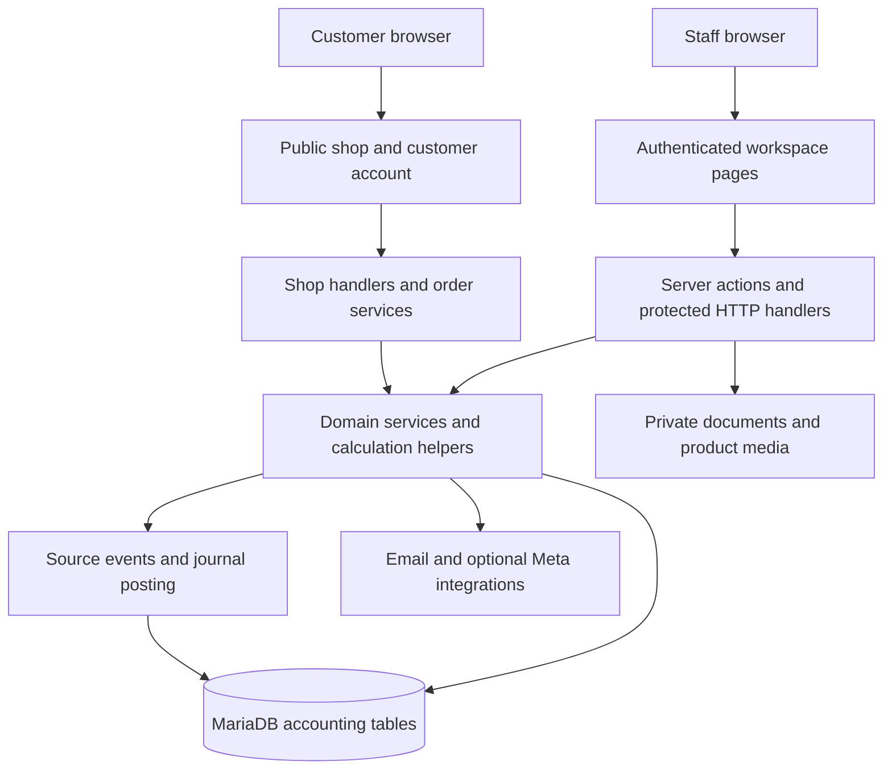
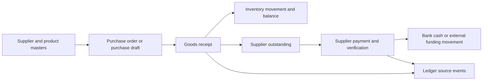
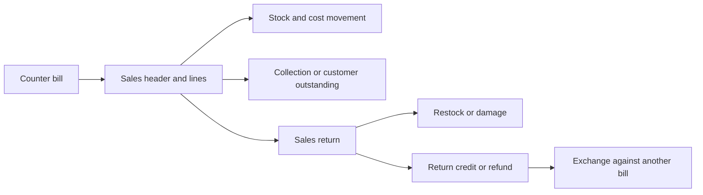

# Project guide

## Architecture

The project uses Next.js 16.4.2, React 19.3.0 and TypeScript, with the App Router under `src/app`. Server components and server actions access SQL through `mysql2/promise`. The committed base dump identifies MariaDB 11.8.9. There is no ORM schema replacing the SQL files.

`src/proxy.ts` separates the public textiles host from the accounting host. This is host routing, not authorization. The workspace layout supplies navigation, search, the division switcher and user identity. Protected pages/actions still need server-side access checks. Shop accounts have a separate session system from staff accounts.

`next.config.ts` enables cache components and partial prefetching, and keeps PDFKit external. Local Next.js guidance is in `node_modules/next/dist/docs/`; page `params` and `searchParams` are asynchronous. Many pages wrap data-reading content in Suspense.

## Developed modules

| Module | Implemented screens and code responsibilities | Main evidence |
| --- | --- | --- |
| Organisation | Group, divisions, branches, users, bank/cash accounts, group rules, bill terms and security | `src/lib/business-master.ts`, `access.ts`, `user-actions.ts`, `navigation.ts` |
| Purchasing | Suppliers, purchase orders, purchase drafts, goods receipts, payments, batched supplier payments and supplier statements | `purchase-order-actions.ts`, `purchase-actions.ts`, `goods-receipt-actions.ts`, `supplier-pay-actions.ts` |
| Inventory | Products/variants, categories, warehouse/branch stock, transfers, counts, low stock, lots, serial labels, free stock and approval stock | `stock-transfer-actions.ts`, `stock-count-actions.ts`, `serial-actions.ts`, `approval-actions.ts` |
| Sales | Counter billing, invoice details, payments, settlement discounts, returns, refunds and exchanges | `sales-actions.ts`, `sale-payment-actions.ts`, `returns-actions.ts`, `return-credit.ts` |
| Pricing | Shop prices, quantity prices, selling prices, offers/coupons, deals and rewards | `qty-price-actions.ts`, `selling-price-actions.ts`, `offer-actions.ts`, `deal-actions.ts`, `rewards-actions.ts` |
| Customers | Customer register/history, notes, ageing, leads, follow-ups and customer/supplier set-off | `customer-actions.ts`, `customer-timeline-data.ts`, `follow-up-actions.ts`, `party-actions.ts` |
| Cash and expenses | Expenses and payments, cash closing/counting, cash denominations, owner money/accounts, advances, staff spending and salaries | `expense-actions.ts`, `cash-closing-actions.ts`, `owner-money-actions.ts`, `salary-actions.ts` |
| Assets | Fixed-asset records and related calculations | `asset-actions.ts`, `asset-math.ts` |
| Accounting | Journals, reversal, chart of accounts, periods, month/year close, opening balances, health and posting retries | `ledger/`, `journal-posting-actions.ts`, `year-end-actions.ts`, `month-close.ts` |
| Funding | Investors/lenders, versioned agreements, generated documents, approvals/amendments, receipts, payouts, participation and reconciliation | `funding-*.ts`, `agreement-*.ts`, `investor-shares/` |
| Reports | Financial reports, cash flow, account movement, sales/purchase analysis, product profitability and auditor exports | `reports/`, `export/`, accounting report pages |
| Online shop | Catalogue, product detail, cart, account registration/login/verification/reset, checkout, order requests and staff order processing | `shop-*.ts`, `src/app/shop/`, `src/app/api/shop/` |
| Catalogue and messaging | Product media, print/share, Instagram/Facebook helpers, reels/music, WhatsApp reports, broadcasts, webhook, chatbot and delivery logs | `catalogue-actions.ts`, `social-actions.ts`, `whatsapp/`, `bot/`, `broadcast-actions.ts` |
| Documents and recovery | Private documents, preview/download, print register, SQL backup and uploaded-file archive | `document-storage.ts`, `document-register.ts`, `backup-dump.ts`, backup routes |

Names above refer to files under `src/lib` unless stated otherwise. See the [code reference](CODE_REFERENCE.md) for individual source links, and the [screen catalogue](SCREENS.md) for every route, including detail and print screens.

## Main workflows

### Purchase to stock to supplier payment

Create or select a supplier and product variants, prepare a purchase order or purchase draft, receive goods, and record the supplier payment against the actual funding account. Inventory receipts and supplier payments are different events. Review stock balances, supplier statements and posting health after confirmation.

Relevant screens include `/accounting/purchase-orders`, `/accounting/purchases`, `/accounting/stock`, `/accounting/pay-supplier` and `/accounting/supplier-statement`. Check partial receipts, partial payments, returns, lots and duplicate submissions in a test database.

### Sale to collection or return

The billing flow selects a permitted branch, customer/walk-in details, products, quantity and applicable prices. The saved invoice and customer collection have distinct effects. Returns reference a sale and may restore saleable stock, record damage, provide credit or refund cash. Exchange credit must be checked against its original return.

See `sales-actions.ts`, `returns-actions.ts`, `invoice-profit.ts`, and their tests. Presence of a saved operational invoice does not by itself prove that all associated journals are posted.

### Expenses and cash

Expenses can have initial and later payments. Account movement depends on the chosen bank, cash, owner or investor source. Cash closing records counted denominations and destinations for money taken out. Separate business-held money from outside personal/investor funding when reconciling totals. See `expense-money-flow.ts`, `reports/cash-flow-data.ts`, `cash-closing-actions.ts` and `owner-accounts-data.ts`.

### Customer follow-ups — migration 078

Customer notes support a kind, follow-up date and completion timestamp. Leads have a separate follow-up date/status in `acct_leads`. The follow-ups page combines these into Overdue, Today, Next 7 days and Later groups, provides phone/WhatsApp links and allows Done or Move.

For a note, Done marks the old note complete; an entered outcome or next date causes a new note to be inserted. For a lead, the action updates the existing note/date and sets FOLLOW_UP when a next date is supplied. Move changes the date. The page currently reads at most 300 leads and 300 notes. See review findings F02 and F05 for failure and completeness limitations. A direct WhatsApp link opens a conversation; it is not evidence of a delivered automated message.

### Funding and profit participation

Funding parties own agreements. Agreements have versions, policies, approval/activation and amendment workflows. Receipts, returns and payouts are separate funding transactions. Participation calculations use effective dates and scope. Investor bank scope, historical funding and opening-balance screens support cutover reconciliation.

Review `effective-profit-participation.ts`, `effective-share-capacity.ts`, `profit-share-validator.ts` and `investor-shares/` together. Never infer a valid current agreement merely from its first version; the integration tests cover amended versions. Profit calculations, allocations and actual cash paid are separate records and require reconciliation.

### Online order request

Customers browse shop-enabled products, maintain a cart, sign in and verify their email, then submit checkout details. The server reloads prices, validates order inputs, locks product variant rows, checks sellable quantities and writes order/header lines in a transaction. Staff process requests on `/accounting/online-orders`. The repository's request workflow is not evidence of a card-payment gateway or completed settlement.

### Ledger posting and reporting

`ledger/source-events.ts` builds drafts from operational sources. `ledger/posting-rules.ts` defines postings; `ledger/post-drafts.ts` validates an open year/period, serializes numbering, checks for already-posted sources, writes balanced lines and records audit evidence. The caller owns the SQL transaction. Database triggers guard posted journal updates/deletes in the base schema.

Automatic posting is controlled by the `auto_post_ledger` business setting. It uses a database lock and per-record transactions and records failures. Opening balances are excluded from automatic selection. An owner-triggered manual run can run while the automatic switch is off. The scheduled endpoint requires a bearer `CRON_SECRET`. Do not invoke it merely to check availability: it can write journals.

Operational sales/stock/cash views and general-ledger reports have different source paths. Reconcile them before asserting that totals represent a completed accounting close. Integer-paise helpers exist; this does not certify every numeric path in the application as free from rounding errors.

## Access model

`src/lib/access.ts` defines feature-to-role and path-to-feature policy. The owner has broad navigation access, except the investor-only home. The precise feature map takes precedence over role descriptions, which can become stale.

| Role | Current intended scope |
| --- | --- |
| GROUP_OWNER | Setup, approvals, funding, accounting administration and operational screens |
| ACCOUNTANT | Dashboard/reports and most operational sales, purchasing, stock, expense and staff workflows; owner-only accounting controls remain separate |
| CASHIER | Sales/returns/customers plus specified counter features such as cash closing, stock count, free-stock requests and limited shop spending |
| DIVISION_MANAGER | Permitted shop-floor features with division restrictions applied by scoped queries/actions |
| AUDITOR | Report and audit viewing/export features without normal operational writes |
| INVESTOR | Own investment view, linked through the login's party ID |

LENDER is a type in the role union but is not in `LOGIN_ROLES`. Authentication currently filters staff access to legal business 1. Do not present this as unrestricted multi-business login support.

Staff credentials use bcrypt. Sessions use random tokens with SHA-256 hashes stored in SQL, an eight-hour lifetime and HTTP-only cookies; production cookies are secure. Optional two-step login uses challenges, TOTP and backup codes. See F01 before relying on its error behavior. Role and scope tests do not prove every page/action has correctly applied those helpers.

## Boundaries of this guide

The guide documents software behavior and source structure. It does not certify financial balances, tax compliance, investor contractual terms, production schema state, provider credentials, delivery of messages or restore readiness. These require the corresponding operational evidence and acceptance checks.
